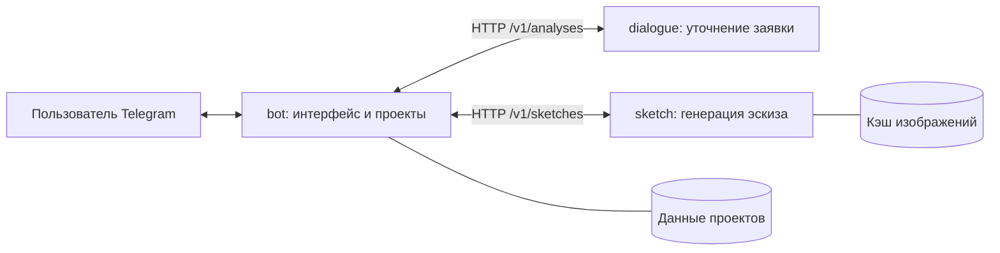

# Архитектура и порядок развития

## Ответственность компонентов

Бот — постоянная точка общения. Он сохраняет историю и состояние проекта,
передаёт данные сервису dialogue и запускает sketch после подтверждения.
Прямых вызовов LLM в боте нет.
Контекст принадлежит нашей базе, а не кратковременной памяти модели.

AI_PROVIDER выбирает OpenRouter либо прямой OpenAI API. Каждый AI-сервис
сам читает локальные настройки и обращается к своему endpoint; API-ключ
не передаётся в SketchRequest. Для диалога OpenRouter используется Chat
Completions с изображениями и JSON-схемой, для генерации — Image API с
input_references. Контракты проекта и разделение микросервисов сохраняются.

Микросервис sketch выполняет только преобразование описания и референсов
в черно-белый эскиз. У него свой процесс, зависимости, HTTP API, Dockerfile,
база запросов, файлы результата и промпт. База Telegram-проектов ему недоступна.

Остальные сервисы реализуются по очереди:

Их описания находятся в [плане развития](roadmap.md); пустые папки сервисов
не обозначают работающую реализацию и удалены из `services` при очистке.

1. dimensions — размерные линии и проверяемая геометрия. Модель помогает
   интерпретировать данные; числовые размеры и соответствие конструкции
   нельзя подтверждать одной картинкой.
2. render — красивое изображение утверждённой конструкции с материалами
   и цветом; не меняет согласованные параметры изделия.
3. detailing — список деталей по правилам конструкции, а не распознавание
   произвольных чисел с красивого рендера.
4. Передача деталировки в существующий раскрой.

Все сервисы получают самостоятельные заявки и возвращают результат по
версионированному контракту. Подключение нового сервиса не переносит в него
Telegram-обработчики и не даёт доступа к внутренним таблицам другого компонента.

## Реализованные самостоятельные единицы

| Компонент | Задача | Хранилище | Точка запуска |
|---|---|---|---|
| bot | Telegram, состояние проекта и последовательность действий | data/bot | run_bot.py |
| dialogue | Анализ эскиза и уточнение описания изделия | Не требуется: контекст приходит в заявке | run_dialogue.py |
| sketch | Создание изображения по согласованному описанию | data/sketch | run_sketch.py |

У каждого свой процесс, зависимости и Dockerfile. Импорты между тремя
компонентами отсутствуют; общие пакеты — только contracts и infrastructure.
Код в одном репозитории не означает один процесс или общую базу.
Бот владеет контекстом пользователя; сервис dialogue не связан с Telegram.
Его API получает Brief, историю и изображения, возвращает Brief, reply и
окончательный список вопросов. Сырые поля модели остаются внутри сервиса.
Проверка обязательных исходных данных перед подтверждением остаётся в боте
(`bot/readiness.py`); это управление этапом, а не анализ изображения.

Промпты: `services/dialogue/prompts/analysis.md` и
`services/sketch/prompts/sketch.md`. Их текст при выделении сервисов сохранён.
После редактирования перезапустите соответствующий процесс.
Настройки моделей остаются прежними; отдельные процессы можно разворачивать
с разными переменными окружения, ключами и провайдерами. Локально для удобства
используется один .env, но загрузчик каждого процесса выбирает только его поля.
Docker Compose передаёт явный набор настроек без общей передачи .env контейнерам.

Новых функций в этом изменении нет. SQLite и схема проектов сохранены.
Перед обновлением рабочая версия опубликована с меткой
`baseline-before-microservices`. Сервисы размеров, рендеринга, деталировки и КП
не реализованы. Фоновая надёжная очередь и ограничения расходов из аудита
также не входят в это изменение.

## Постоянный диалог и версии

Проверка конструкции находится в `services/dialogue/src/rules.py`. Анализирующая модель
возвращает `is_cabinet` и `cabinet_sections`: для каждого отделения — состояние
дверей, полноту сведений о них и о наполнении. Неизвестные значения превращаются
в обязательные вопросы даже при пустом `questions` от модели. Для утверждения
«дверей нет» требуется цитата, найденная в пользовательских сообщениях;
ответ самой модели не считается подтверждением. Проверка цитаты подтверждает
её происхождение, но её смысл и связь с отделением всё ещё интерпретирует LLM.
Распознавание по фотографии не становится безошибочным благодаря этой проверке.

Показываются до трёх вопросов за раз; оставшиеся препятствуют генерации.
В ответе анализирующей модели `questions` содержит объекты с текстом,
темой (`doors`, `interior`, `contradiction`, `other`) и индексом отделения
в `cabinet_sections`. Вопросы `doors`/`interior`, уже покрытые программной
проверкой того же отделения, не добавляются повторно. Сравнение не зависит
от буквального совпадения формулировок. Противоречия и другие темы сохраняются,
в том числе вопрос о ручках при отсутствии дверей. В базе и интерфейсе
по-прежнему хранятся обычные строки; миграция прежних вопросов не нужна.
Классификацию смысла и привязку к отделению выполняет LLM; вопросы с неизвестной
привязкой не удаляются. Эта проверка не гарантирует безошибочную классификацию.
Показанные вопросы, включая программные вопросы о габаритах, сохраняются
с номерами в истории диалога, чтобы следующий ответ «1. да, 2. нет» имел контекст.
Сервис sketch получает прежний самостоятельный контракт: `Brief` и референсы.
Подтверждённая конструкция должна полностью содержаться в `Brief.description`.
Механизмы записываются в `hardware`, двери и фасады — в описание конструкции.

Для шкафа с дверями промпт генератора задаёт внешний вид, вид наполнения
с условно скрытыми дверями и общий объёмный вид одного изделия. При необходимости
добавляется изображение тех же дверей/фасадов отдельно. На данном этапе это
инструкция генератору, а не программная проверка совпадения геометрии видов.
Размерные линии и размеры дверей относятся к будущему сервису dimensions.

В интерфейсе «Эскиз №N» означает порядковый номер сохранённого изображения
в конкретном проекте. `artifacts.sketch_number` присваивается один раз; повторное
сохранение того же результата не увеличивает номер. Старые изображения получают
номера при миграции по порядку сохранения. Внутренние номера ревизий продолжают
связывать заявки, подтверждения и кэш сервиса, но не показываются как номер эскиза.
Существующие описания не переписываются автоматически: новые правила анализа
применяются после следующего сообщения пользователя или повторного анализа.

- Новый проект создаётся явно. Обычное сообщение относится к открытому проекту.
- Новые данные записываются до ожидания длительного запроса к модели.
- Изменения создают новую версию и снимают подтверждение для нового результата.
- Подтверждение относится к конкретной версии. Старая кнопка не запускает
  генерацию новой версии без её проверки.
- Чертёж привязан к версии заявки. Уточнение во время генерации не превращает
  старую картинку в результат обновлённого проекта.
- Навигация и идентификатор карточки сохраняются в SQLite. Возврат к списку
  оставляет последний выбранный проект доступным для сообщений.
- Порядковый номер выдаётся каждому пользователю отдельно: максимальный
  среди существующих проектов плюс один. После удаления всех проектов — №1.
  Название можно изменить; для нумерации используется сохранённый номер.
- Имя принадлежит пользователю, а не модели; переименование не меняет версию
  изделия или payload уже утверждённого запроса к сервису sketch.
- Удаление требует подтверждения. Удаляются данные и файлы в хранилище бота;
  поздние ответы модели игнорируются. Кэш сервиса остаётся независимым.
- Архивные версии доступны для просмотра. Автоматического отката по нажатию
  на архивную версию нет.
- Сейчас храним всю переписку. В запрос передаём текущее описание, последние
  80 сообщений, последние эскизы и предыдущий результат — не всю базу.

## Назад

После первого сохранённого рисунка в проекте появляется единственная кнопка
«Чертежи». Она открывает общий список, включая последний результат, от новых
к старым. Список листается по 20 рисунков; старые результаты не исчезают
за пределами первой страницы. Возврат из просмотра рисунка ведёт на ту же
страницу списка. Просмотр не запускает генерацию и не изменяет данные проекта.
Прежний callback `drawing` также открывает общий список для совместимости.

- Из карточки, данных изделия или результата → к списку проектов.
- Из истории → к карточке текущего проекта.
- Из архивного чертежа → к списку чертежей.
- Из переименования или подтверждения удаления → к карточке проекта.

Навигация не удаляет данные и не отменяет уже начатую генерацию.
Отключение модели или сервиса не мешает открыть сохранённое описание и историю.

Все кнопки редактируют одну карточку. Текст заменяется через editMessageText,
фото — через editMessageMedia, подпись — через editMessageCaption. После фото
при текстовой навигации изображение заменяется нейтральной полосой, чтобы
не показывать чертёж другого проекта. Длинные тексты листаются по страницам.
Удалённая пользователем карточка восстанавливается командой /menu.
Явные /start, /menu и /help создают новую карточку в конце переписки,
чтобы редактирование старого сообщения не выглядело отсутствием ответа.
Навигация кнопками продолжает редактировать текущую карточку.
Новый текст, фото или файл получают ответ ниже сообщения пользователя.
Под блокировкой интерфейса сравниваются идентификаторы входящего сообщения
и текущей карточки: если пользовательский ввод новее, отправляется новая
карточка. Последующие обновления этого ввода редактируют её; поздний ответ
на более ранний ввод не создаёт дополнительную карточку. Прежние сообщения
сохраняются в чате, а их кнопки отклоняются как устаревшие.

## Данные для раскроя — следующий этап

Передавать нужно **готовые размеры деталей и кромку по сторонам**.
Калькулятор сам уменьшает размер заготовки на толщину кромки; передача уже
уменьшенных размеров вызовет повторное вычитание.

Текущий калькулятор работает с одним материалом, толщиной и форматом листа
за расчёт. Деталировка проекта должна делиться на соответствующие группы.

## Границы первой проверки

Нет размерных производственных чертежей, красивых рендеров, деталировки,
раскроя из эскиза и распознавания голосовых сообщений.
Первый тест проверяет диалог, понимание эскиза, согласование конструкции,
генерацию черно-белого эскиза и последующие правки.
